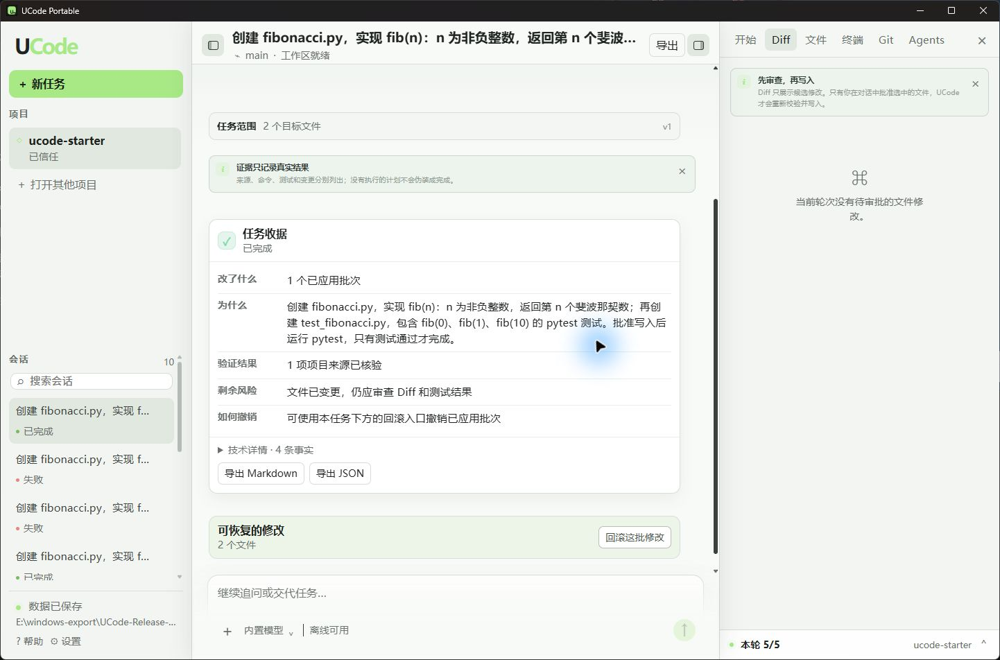
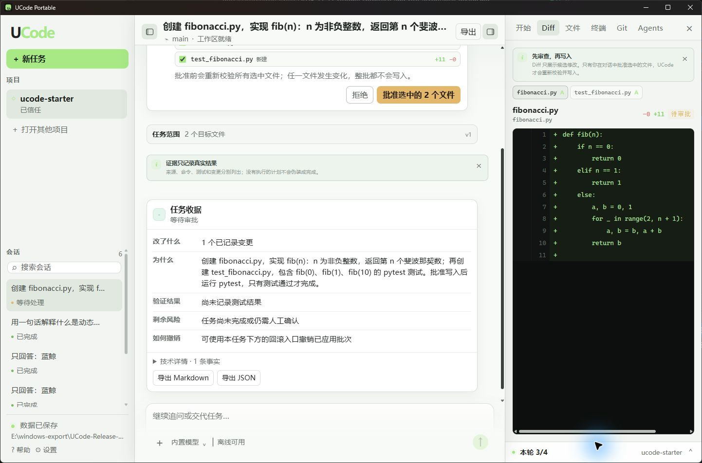
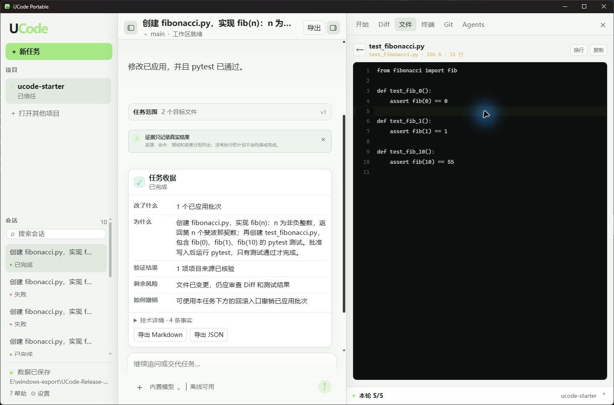

<div align="center">

# UCode

### 把项目、模型与执行证据一起装进 U 盘

**A local-first, evidence-driven coding desktop for Windows.**

[](https://www.microsoft.com/windows)
[](https://tauri.app/)
[](#模型与边界)
[](#验证状态)
[](LICENSE)

UCode 不是把聊天网页套进桌面壳。它把项目读取、变更审批、真实测试、回滚和证据收据放进同一条本地工作流。

</div>



## Ask → Review → Verify

| 1. Ask：交代任务 | 2. Review：审查修改 | 3. Verify：只相信真实结果 |
|---|---|---|
| 用自然语言描述目标、文件和验收条件。普通问答不会被强迫调用工具。 | UCode 先生成 Diff；写入前必须由用户批准，并在落盘前再次校验文件状态。 | 指定测试真实运行；结果、来源、变更和审批进入可导出的证据收据。 |

<p align="center">
  
  
</p>

## 为什么是 UCode

- **便携优先**：应用、运行时、模型和数据采用相对布局；盘符迁移已有自动测试，真实跨机器与拔插仍待验收。
- **本地优先**：默认使用随包验证的 GGUF 模型；只有用户主动配置时才连接 OpenAI 兼容端点。
- **Harness 强于提示词**：路由、路径边界、审批、事务写入、测试和回滚由宿主控制，不依赖模型“自觉”。
- **证据先于自信**：已覆盖的任务路径只依据实际读取、执行和测试结果生成完成收据；未覆盖路径仍按原型软件审慎使用。
- **为小模型收敛范围**：确定性意图路由、真实文件索引、有限重试和任务停止条件，减少 1.5B 模型的随机失控。

## 已验证工作流

2026-11-17 的真实便携桌面验收使用以下任务：

> 创建 `fibonacci.py`，实现 `fib(n)`；创建 `test_fibonacci.py`，覆盖 `fib(0)`、`fib(1)`、`fib(10)`；批准写入后运行 pytest，只有测试通过才完成。

实际结果：

- 两个文件在同一审批批次中生成并真实落盘；
- 测试文件导入真实实现，没有复制被测函数；
- UCode 只运行本轮测试文件：`pytest test_fibonacci.py`；
- 独立复验结果：`3 passed in 0.02s`；
- Files 面板内容与磁盘一致；只读 Agent 报告 3 条覆盖用例且未修改文件；
- Terminal 成功启动持久 PowerShell 会话；非 Git 项目被如实识别，没有自动初始化仓库。

2026-11-18 又完成了 Rescue R2 的候选桌面验收：UCode 从真实 `HKCU\Environment\Path` 生成可审查方案，审批后写入并重读验证，再从桌面精确回滚；随后用新打包候选执行中文只读诊断，并在 SQLite 事件中复核流式文本无 UTF-8 损坏。完整记录见 [Rescue Phase 2 验收报告](docs/benchmarks/2026-11-18-rescue-phase2-r2-acceptance.md)。

## 能力矩阵

“真实桌面”与“自动测试”分开列出，避免把入口存在或单元测试写成已经完成的用户验收。

| 能力 | 真实桌面验收 | 自动测试 | 当前边界 |
|---|---|---|---|
| 普通聊天、代码解释、多轮追问 | 已验收 | Node + React | 受 1.5B 模型表达能力限制 |
| 单轮只读附件上下文 | 已验收：项目文件与外部只读附件可同时加载并据实回答 | Rust + React + Executor | 最多 8 个 UTF-8 文本；单文件 256 KiB，总上下文 120,000 bytes；每轮独立，避免旧任务串话 |
| 项目文件列表、读取、引用来源 | 已验收 | Node + React | 大仓库只做有界索引与读取 |
| 单文件与小型多文件修改 | Fibonacci 双文件通过 | Node + Rust | 写入必须审批 |
| pytest 定向执行 | `3 passed in 0.02s` | Node | 失败回传已自动测试，尚待桌面失败路径复核 |
| 项目事务写入、过期检测、回滚 | 已见真实写入与回滚入口 | Node + Rust | 项目写入的中途故障恢复主要由自动测试证明 |
| Rescue R0 只读系统诊断 | Windows 11 真实探针、报告与证据收据已验收 | Node + Rust + 桌面 | 只覆盖已注册的有界探针；不等于全能系统诊断 |
| Rescue R2 用户 PATH 修复与回滚 | 已真实审批、写入验证、独立复核并精确回滚 | Rust + 桌面 | 当前只启用 `system.user_path.normalize@1`；机器级与高风险修复仍禁用 |
| 持久终端与 Ctrl+C | 已验证 PowerShell 会话启动 | Rust PTY | 持久交互与 Ctrl+C 主要由自动测试证明 |
| Git 状态、Diff、历史与操作 | 已验证非仓库诚实降级 | Rust | 真实 Git 仓库的完整操作流仍待人工复核 |
| 只读 Agent | 已验收，无文件写入 | Rust + React | 只做有界项目分析 |
| 隔离编辑 Agent / Worktree | 尚未真实项目验收 | Rust | 实验性；合并前仍需两次审批 |
| 深浅主题、字号、可拖拽面板 | 已验收 | React | 仍需更多分辨率与缩放比例测试 |
| 托盘、提示音、完成通知 | 已见设置与身份诊断 | Rust + React | 完整后台通知用户流仍待人工复核 |

### 文本附件与文件格式

“＋”添加的是本轮只读上下文，不会自动写入项目。项目内文件保留相对路径；项目外文件只发送不暴露磁盘路径的只读快照。发送前 UCode 会重新校验文件摘要，选择后发生变化的附件必须重新添加。

重点支持的文本格式包括：`md, txt, js, mjs, cjs, ts, tsx, jsx, py, rs, go, java, kt, c, h, cpp, hpp, cs, json, jsonl, yaml, yml, toml, ini, cfg, xml, html, css, scss, sql, sh, ps1, bat, cmd, log, csv`。附件实际以内容为准：其他扩展名只要是有效 UTF-8 文本也可以作为只读上下文；图片、PDF、Office 文档、压缩包、数据库和可执行文件当前不支持直接解析或编辑。

## 模型与边界

便携包当前使用 **Qwen2.5-Coder 1.5B Q4_K_M**（约 1.04 GiB；UCode 当前运行配置为 4,096 上下文）。它不是 UCode 自研或重新训练的权重；UCode 的工作集中在桌面产品、执行 Harness、安全策略和可验证工作流。

推荐任务范围：

- 目标明确，点名 1–3 个相关文件；
- 修改可以通过指定测试或命令验证；
- 常见脚本、函数、配置、小型缺陷修复和项目解释。

不应把当前版本当作：

- Codex、Claude Code 或 Cursor 的完整替代品；
- 可无人值守完成大型重构、复杂架构迁移或开放式仓库探索的 Agent；
- 具有强视觉理解、长上下文推理或可靠跨语言大型改造能力的模型平台。

模型能力上限与 Harness 能力是两件事：Harness 可以阻止越界、虚报和未经批准的写入，但不能把 1.5B 模型变成前沿大模型。更复杂任务建议接入用户自选的 OpenAI 兼容强模型，同时保留 UCode 的本地审批与执行边界。

完整边界见 [CAPABILITY_BOUNDARY.md](CAPABILITY_BOUNDARY.md)。

## Super Agent 思想如何落地

UCode 借鉴 DeepSeek `dsh-superagent-prototype` 的生命周期思想，而不是复制其产品或宣称完全兼容：

```text
用户触发
  → 确定性意图路由
  → Ticket / Assignment 建模
  → 有界 Agent 读取与规划
  → Effect 变更提案
  → 用户 Mandate 审批
  → 宿主事务执行
  → Report / Delivery
  → Evidence Receipt
```

关键原则是：**模型提出动作，宿主决定动作是否允许，真实执行结果决定任务是否完成。**

架构细节见 [ARCHITECTURE.md](ARCHITECTURE.md)。

## 开发与构建

需要 Node.js 22+、Rust stable（MSVC target）、WebView2 与 Windows Build Tools。

```powershell
npm install
npm run check

Set-Location desktop
npm ci
npm test -- --run
npm run build
cargo test --manifest-path src-tauri/Cargo.toml
```

运行开发桌面壳：

```powershell
Set-Location desktop
npm run tauri dev
```

仓库不包含模型权重、运行数据或 2+ GiB 的完整便携胶囊。模型包与离线构建说明见 [model-packs/README.md](model-packs/README.md) 和 [BUILDING.md](BUILDING.md)。

## 验证状态

发布前至少执行：

- Node Harness 全量测试；
- React/Vitest 全量测试；
- Rust/Tauri 全量测试；
- Vite 与 Tauri release 构建；
- 便携 staging 完整性检查；
- 真实桌面聊天、审批、文件、测试、终端、Git 降级、Agent、主题与布局验收。

最近一次正式候选验收的构建摘要、测试计数、桌面步骤与已知限制见 [2026-11-18 Rescue Phase 2 验收报告](docs/benchmarks/2026-11-18-rescue-phase2-r2-acceptance.md)。

自动测试不能替代第二台 Windows 电脑与真实 U 盘拔插验证。项目仍处于个人/研究产品阶段，欢迎以可复现任务、日志和截图提交 Issue。

## License

源代码采用 [Apache-2.0](LICENSE)。模型、运行时、依赖、字体、图标与声音资源保留各自许可证，详见 [THIRD_PARTY_NOTICES.md](THIRD_PARTY_NOTICES.md)。
